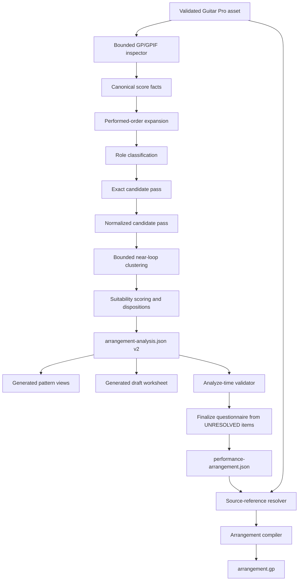

# Research Report: Redesigning `vp-music-analyze` for Reliable Live-Loop Finalization

## Executive Summary

The proposal is directionally correct: analysis should stop trying to turn every scored part into a loop, treat live performance as the default for unsuitable material, prioritize repetitive accompaniment, surface near-loop decisions explicitly, and preserve exact Guitar Pro provenance for later arrangement construction. The current implementation fails mainly because it flattens Guitar Pro evidence into lossy note tuples, makes `arrangement.json` optional, duplicates authoritative facts across JSON and Markdown, detects only exact repeats, and discovers many contract errors only during final export.[^1][^2][^3]

Three important modifications are needed. First, **4/8 bars and three patterns per instrument must be configurable defaults, not universal rules**: manufacturer documentation supports deliberate, meter-aligned loop lengths but neither mandates 4/8 bars nor a three-pattern maximum.[^4][^5][^6] Second, **do not embed raw GPIF XML in Markdown pattern files**: GPIF is a cross-referenced object graph, snippets are difficult to transplant safely, and copied notation can create copyright and repository-leakage risks.[^7][^8] Use a source digest plus positional score coordinates, with an optional local cache that is never authoritative or committed. Third, the handoff should become a single machine-readable analysis model that classifies every relevant span as `LOOP`, `LIVE`, `OPTIONAL`, or `UNRESOLVED`; Markdown should be generated as a human view rather than maintained as an independent source of truth.

The recommended implementation sequence is: (1) introduce a v2 analysis contract and analyze-time validator; (2) add deterministic performed-order expansion for repeats/endings/directions; (3) replace blunt exact-only selection with role gating plus exact, normalized, and bounded near-loop stages; (4) add digest-guarded Guitar Pro source references and prove one end-to-end source-reuse vertical slice; and only then (5) add advisory music-theory scoring. This fixes the analyze-to-finalize seam before increasing musical sophistication.

## Query Classification and Scope

This is a **technical deep-dive and planning study**. It covers:

- the current repository's analyze/finalize contract and failure modes;
- Guitar Pro/GPIF structure, repeat expansion, and source reuse;
- symbolic pattern-recognition options;
- live-loop preparation practice and manufacturer capabilities;
- a rule-by-rule assessment of the proposal;
- a target architecture, schema, algorithm, migration, and test plan;
- a bounded next iteration for music-theory-informed prioritization.

The repository is local-only at commit `cee4e563cd64d27e834dc35d389c962a255d0a22`; no GitHub remote was configured, so repository citations use local paths and line ranges rather than fabricated links.[^9]

## Current-State Findings

### Analyze and finalize are coupled through a fragile three-artifact contract

Analyze is instructed to create per-instrument pattern Markdown, a draft worksheet, and optionally `arrangement.json`; finalize reads these artifacts and compiles `performance-arrangement.json`, a published worksheet, and `arrangement.gp`.[^1] In practice:

- `arrangement.json` is optional even though it is the only note-level machine handoff;
- Markdown names, ordering, counts, section bars, status, tempo, meter, and active-pattern lists must match JSON exactly;
- pattern names must agree across JSON, worksheet legend, and pattern-file headings;
- unknown JSON fields are rejected, making schema evolution an all-at-once change;
- finalize has no reliable machine-readable distinction between a deliberate live part, an optional omission, and an unresolved analysis gap.[^2][^3]

The writer constructs a new alphaTab score from numeric events; it does not reopen the source Guitar Pro file or reuse original bars. The repository's GPIF parser resolves `MasterBar → Bar → Voice → Beat → Note` references but emits only reduced position, pitch, string, fret, and duration data. Bends, slides, dynamics, voices, tuplets, ties, grace notes, lyrics, chord diagrams, alternate endings, and other notation are lost before finalization.[^2][^10]

### Pattern detection is exact-only and role gating is superficial

`pattern_candidates.py` slides 1/2/4/8-bar windows, groups exact `(relative onset, pitch, duration)` signatures, requires repeated non-overlapping occurrences, ranks by covered bars, suppresses heavily overlapping candidates, and caps results per track. Its only automatic role exclusion is a track-name regex for vocal/voice/solo terms.[^11]

This is a reasonable high-confidence first stage, but it cannot:

- recognize transposed or octave-shifted repetitions;
- tolerate an ornamental fill or a changed turnaround bar;
- distinguish a useful four-bar near-loop from two coincidental repeated bars;
- infer whether a repetitive lead should be looped;
- prevent a sparse or slowly evolving part from being patternized merely because some windows repeat.

### The real analyze-to-finalize seam is not tested

Writer and parser tests use synthetic manifests or isolated score fixtures. No committed, rights-safe fixture exercises the full path from Guitar Pro inspection through analysis output, finalization input, source verification, and GP export. Real songs are under an ignored `songs\` tree, so tests referencing them are not reproducible on a fresh clone. The repository's only populated legacy worksheet also fails the current worksheet checker, demonstrating schema drift without migration.[^12]

## Proposal Validation Matrix

| Proposed rule | Verdict | Recommended contract wording |
|---|---|---|
| Some components are performed live; do not patternize everything | **Accept** | Every analyzed span must receive a disposition. `LIVE` is the safe default when loop suitability is not positively established. Absence of a loop is not an analysis failure. |
| Solo, vocals, and a single lead are good live candidates; drums, percussion, bass, and rhythm are good loop candidates | **Accept with modification** | Use role as a prior, not a verdict. Favor stable rhythmic/accompaniment roles for loops and expressive/variable lead roles for live play, but allow repetitive multi-lead ostinati and require evidence from note density, monophony/polyphony, repetition, register, track metadata, and section function. |
| Multiple simultaneous repetitive leads may be looped | **Accept** | Permit them when each has a stable repeat, the combined layer count is feasible, and the performer can still execute required live material and transitions. |
| Sequential common-meter repeated bars and reprise notation are good candidates | **Accept with modification** | Common meter and explicit repeats increase suitability, but candidates must also have a clean seam, stable performed-order context, and no unresolved boundary dependencies. Reprise notation is structural evidence, not proof that every repeated track should become a loop. |
| Unusual-meter non-repetitive bars are likely live | **Accept with modification** | Mark non-repetitive or meter-changing material `LIVE` by default. Odd meter alone is not disqualifying: repeated 5/4 or 7/8 phrases can be excellent loops. |
| Up to three patterns per instrument, prioritized by frequency | **Accept as a default, not a law** | Default `max_patterns_per_instrument = 3`; rank by repeated coverage, occurrence count, seam quality, section usefulness, and transition cost. Allow explicit override when formal sections genuinely require more. No manufacturer source establishes three as an industry limit.[^4][^5][^6] |
| Loops are typically 4 or 8 bars; longer repetitions are immediately live | **Reject as an absolute** | Prefer the shortest musically complete cycle, commonly 1/2/4/8 bars, and impose a configurable soft maximum (default 8). Longer candidates receive a penalty and explicit feasibility review rather than automatic rejection. Manufacturer systems permit arbitrary or user-selected lengths; Boomerang even recommends a short 1–2-measure master in one workflow.[^4][^5][^6] |
| Live play is the default for everything that cannot be looped | **Accept** | Use `LIVE` for deliberate manual performance; use `UNRESOLVED` only when analysis cannot yet decide. Do not conflate live play with a blocker. |
| More than two patterns should trigger near-loop review and a user question | **Accept with modification** | Trigger review based on near-duplicate clusters, not raw pattern count. Ask only when choosing a canonical pattern would alter notes, bar length, harmony, or performance behavior. Present exact coordinates as `track name, written bars X-Y`, include occurrences and the divergent bars, and offer preserve/normalize/live/omit choices. |
| Communicate source coordinates as `track name, bars X-Y` | **Accept with extension** | Use `track name, written bars X-Y`; when repeats/endings/directions matter, append performed occurrence and ending context, e.g. `Rhythm Guitar, written bars 12-15, occurrence 2, ending 2`. |
| Do not validate authoritative GP duration against the original recording | **Accept** | Treat the validated score's performed-order map as authoritative for score-based analysis. Report internal score inconsistencies, but do not reject it for differing from a commercial recording duration. |
| Embed GPIF snippet or pointer so finalize can reuse source bars | **Accept pointer; reject raw snippet as the primary design** | Store a digest-guarded positional source reference. GPIF IDs are document-local and may be shared or renumbered; raw fragments require reference closure and ID rewriting. A local resolved cache may exist, but it is non-authoritative and must not be committed.[^7][^8] |
| Mark low-density one-off intros/outros/bridges potentially skippable | **Accept with modification** | Low density is one signal. Mark `OPTIONAL` only when the span is structurally nonessential, transition-safe, and not a defining hook, pickup, cadence, count-in, or required setup window. Finalize decides omission. |
| Add music-theory analysis later | **Accept and defer** | First stabilize provenance, performed order, dispositions, and candidate detection. Then add theory features as advisory re-ranking signals that may abstain; they must never invent note evidence or override source provenance. |

## Target Architecture



### One authoritative analysis model

Create a v2 machine-readable handoff, preferably named `arrangement-analysis.json` during migration to distinguish it from the current export-oriented manifest. It should be authoritative for:

- source assets and checksums;
- written and performed bar maps;
- track roles and role confidence;
- candidate matches and similarity evidence;
- selected patterns and dispositions;
- source references;
- unresolved decisions and dependencies;
- section structure and simplification options.

Pattern Markdown and the draft worksheet should be generated views. Humans may add explanatory prose, but names, bars, statuses, dispositions, and source coordinates must not become independently editable truths. This removes the current byte-exact synchronization problem rather than adding more cross-file checks.[^3]

### Required disposition vocabulary

Use one closed enum:

```json
{
  "disposition": "LOOP | LIVE | OPTIONAL | UNRESOLVED"
}
```

- `LOOP`: reusable material selected for loop construction.
- `LIVE`: intentionally performed manually and not a blocker.
- `OPTIONAL`: source material that may be omitted or simplified without invalidating the arrangement.
- `UNRESOLVED`: a decision finalize must ask about before a complete result can be published.

An `UNRESOLVED` item must not survive into a Final `performance-arrangement.json`. A Partial result may retain it only as an explicit limitation with scoped user consent, following the existing Partial/Final model.[^13]

### Recommended source-reference model

Use positional coordinates anchored to a digest-matched source:

```json
{
  "source_ref": {
    "asset_sha256": "sha256:...",
    "asset_relative_path": "source/song.gp",
    "track_index": 2,
    "track_name": "Rhythm Guitar",
    "staff_index": 0,
    "written_master_bars": [12, 15],
    "voice_indices": [0],
    "performed_occurrences": [1, 2, 3],
    "ending_context": null,
    "content_fingerprint": "sha256:..."
  }
}
```

Do **not** use raw GPIF `id` attributes as durable keys. GPIF uses document-scoped IDs and shared references; alphaTab clones beat/note objects when attaching them because definitions can be shared across occurrences. IDs can also be renumbered when the file is saved. Within a digest-matched source, raw IDs may be retained as diagnostic acceleration hints, but the durable locator is positional and content-fingerprinted.[^7]

Do **not** put absolute local paths in persisted artifacts. The current inspector resolves and emits absolute paths, which can disclose usernames and workstation layout; store a song-relative path plus SHA-256 instead.[^8]

### Minimal v2 sketch

```json
{
  "version": 2,
  "source": {
    "asset_relative_path": "source/song.gp",
    "asset_sha256": "sha256:...",
    "format": "gpif"
  },
  "performed_order": [
    {
      "performed_bar": 1,
      "written_bar": 1,
      "occurrence": 1,
      "ending": null,
      "meter": "4/4",
      "tempo_bpm": 120
    }
  ],
  "tracks": [
    {
      "name": "Rhythm Guitar",
      "role": "rhythm",
      "role_confidence": "likely",
      "spans": [
        {
          "id": "rhythm-verse-a",
          "written_bars": [9, 12],
          "match_tier": "near",
          "disposition": "UNRESOLVED",
          "occurrences": [
            {"written_bars": [9, 12], "performed_bars": [9, 12]},
            {"written_bars": [17, 20], "performed_bars": [17, 20]}
          ],
          "near_match": {
            "matching_bars": 3,
            "total_bars": 4,
            "divergent_bar_offsets": [3]
          },
          "source_ref": {}
        }
      ]
    }
  ],
  "decisions": [
    {
      "id": "decision-rhythm-verse-a",
      "question": "Preserve the fourth-bar variation or use the common loop?",
      "coordinates": [
        "Rhythm Guitar, written bars 9-12",
        "Rhythm Guitar, written bars 17-20"
      ],
      "options": ["preserve_variants", "use_canonical", "play_live", "omit"]
    }
  ]
}
```

## Performed-Order Expansion

Guitar Pro bar structure is score-wide: all tracks share a `MasterBar` timeline, while bars/voices/beats/notes are track-specific. Repeats, alternate endings, directions, meter, tempo, and pickups therefore must be resolved before pattern occurrence counting.[^14]

Adopt a deterministic model based on alphaTab's playback controller:

1. Build repeat groups in written order, allowing nested groups and multiple closings.
2. Maintain a stack of active groups and per-closing iteration counters.
3. Propagate alternate-ending masks across multi-bar endings.
4. Expand each played master bar into a performed occurrence record.
5. Handle DC/DS/Coda/Fine with a separate state machine before normal repeat advancement.
6. If a jump target is missing, report a diagnostic and continue linearly rather than looping indefinitely.
7. Treat an unclosed repeat start as inert.
8. Put a maximum performed-bar count and state-visit count on expansion to block malformed infinite navigation.

Coordinates shown to users remain written coordinates, with occurrence context added only when necessary. This satisfies the requested `track name, bars X-Y` convention without hiding ambiguity.

Boundary checks must flag:

- ties entering or leaving the candidate;
- grace notes borrowing time across a boundary;
- tuplets split by a boundary;
- pickups/anacrusis and incomplete measures;
- tempo/meter changes within a candidate;
- multiple independent voices;
- let-ring, pedal, bends, slides, whammy, and other effects whose audible tail crosses the seam;
- percussion articulations whose meaning depends on track-local mappings.

These do not all prohibit looping. They lower seam confidence or create an explicit simplification decision.

## Recommended Pattern Algorithm

### Stage 0: role gating

Classify each track using track metadata plus symbolic evidence:

- percussion channel/articulation;
- pitch range and register;
- monophony/polyphony and chord density;
- repetition and onset density;
- name/instrument program;
- researched function where available.

Return a role and confidence, not a binary exclusion. Default priors:

- drums/percussion/bass/rhythm/accompaniment: positive loop prior;
- lead vocal/solo/single expressive lead: positive live prior;
- repetitive simultaneous leads/ostinati: neutral-to-positive loop prior;
- unknown: no prior.

### Stage 1: exact canonical matching

Keep the current exact signature approach as the highest-confidence pass. Extend lengths to configurable meter-aware candidates rather than hard-coding only 1/2/4/8, while retaining those as preferred spans. An exact match should preserve pitch, rhythmic positions, duration, voice, and essential performance properties.[^11]

### Stage 2: normalized matching

Compute declared alternative signatures:

- octave-normalized or interval-contour pitch;
- transposition-normalized pitch where musically appropriate;
- quantized rhythmic grid;
- optional exclusion of nonessential ornaments.

Every transform must be recorded. Normalized matches are candidates, not automatically equivalent loops.

### Stage 3: bounded near-loop detection

Use exact or normalized single-bar signatures as anchors. For each 2/4/8-bar candidate, compare bar-by-bar and identify clusters such as 3-of-4 matching bars. Only run more expensive note-level edit distance on divergent bars. This captures fills and turnarounds without an all-pairs whole-song fuzzy search.

Near-loop questions should be generated only if:

- the variant changes the selected loop's notes or length;
- the variant recurs enough to matter;
- no source-preserving implementation can represent both cheaply;
- the answer affects final performance.

### Stage 4: suitability scoring

Rank candidates using:

```text
score =
  repeated_coverage
  + occurrence_frequency
  + seam_quality
  + role_prior
  + section_utility
  - transition_cost
  - boundary_dependency_penalty
  - excessive_length_penalty
  - near_match_uncertainty
```

Guardrails:

- minimum two occurrences;
- do not cross section or meter boundaries unless explicitly intended;
- default maximum three selected patterns per instrument;
- default soft length maximum eight bars;
- warn when one pattern claims most of a long, evolving track;
- do not manufacture a loop merely to satisfy a target count;
- classify remaining spans `LIVE`, `OPTIONAL`, or `UNRESOLVED`.

Full SIATEC/COSIATEC-style geometric discovery is unnecessary for the first redesign. It is valuable for unconstrained motif discovery in dense polyphony but is computationally and conceptually broader than bar-aligned live-loop selection.[^15][^16] Retain it as an optional future fallback if the staged method returns no candidates for a track known to contain recurring motifs.

## Live-Loop Practice Findings

Primary manufacturer documentation validates several structural principles:

- deliberate synchronization and measure-based loop length are common;
- one-shot material and discrete verse/chorus/bridge phrases are supported workflows;
- transitions often occur at loop boundaries;
- track and memory architectures vary substantially;
- arbitrary/free loop lengths remain valid.[^4][^5][^6]

Boomerang III explicitly describes Serial mode as one loop each for verse, chorus, and bridge, switching gaplessly when the current loop ends.[^5] Boss RC-600/RC-505mkII provide per-track measure counts, loop/tempo synchronization, one-shot playback, and memory recall, but do not prescribe 4/8 bars.[^4] Ableton supports user-selected or free record length, launch quantization, follow actions, and sync-preserving clip transitions.[^6]

The practical arrangement principle is therefore not “everything repetitive becomes a loop.” It is:

> Loop stable foundation material whose repetition reduces workload and preserves the song's identity; perform expressive, variable, or structurally awkward material live; omit only material whose removal does not damage recognition, form, transitions, or performance feasibility.

No authoritative source found a universal numerical layer or pattern maximum. Three patterns per instrument is defensible as this project's complexity-control default, not as a claimed live-looping standard.

## GPIF Reuse, Rights, and Security

### Why raw snippets should not be the primary handoff

GPIF is not a self-contained nested bar format. Master bars refer to track bars, bars to voices, voices to beats, beats to notes and rhythms, while tempo, directions, percussion mappings, and effects live elsewhere. Copying one bar's XML requires calculating reference closure, carrying effective state, remapping IDs, preserving boundary dependencies, and resolving shared definitions.[^7]

Raw snippets also reproduce source notation. The repository's existing contract correctly frames the generated arrangement as an original reduction and warns against wholesale tab/lyric reproduction. Persisting substantial GPIF XML or copied note arrays in Markdown or tracked JSON would undermine that policy.[^8]

### Safe architecture

- Parse locally with bounded tools.
- Store source checksum, relative path, positional coordinates, and a short content fingerprint.
- Resolve references only against the digest-matched local source.
- Materialize selected bars directly into the output score at finalize time without persisting raw source XML in Markdown.
- Store only original reduction metadata and short human summaries in tracked artifacts.
- Invalidate references when the digest changes.

The existing parser already blocks dangerous archive paths, encrypted entries, excessive entry count/size/compression ratio, DOCTYPE/ENTITY declarations, and excessive XML object counts. Any new resolver must preserve those controls.[^8]

Current dependency licenses should be documented accurately: alphaTab's current core license is MPL-2.0, PyGuitarPro is LGPL-3.0, and MuseScore is GPLv2-or-later. Prefer existing dependency APIs or external-process invocation; do not copy GPL parser implementation into repository code.[^8]

## Planning Roadmap

### Phase 1: stabilize the contract

**Goal:** make analyze outputs deterministically consumable before improving pattern intelligence.

Changes:

- add v2 schema documentation;
- introduce dispositions and structured decisions;
- make JSON authoritative and generate Markdown views;
- add `write_arrangement.mjs --validate-only` or an equivalent shared validator;
- run validation during analyze, not first during export;
- support v1 and v2 concurrently.

Primary files:

- `skills\vp-music\CONTRACT.md`
- `skills\vp-music\analyze\SKILL.md`
- `skills\vp-music\finalize\SKILL.md`
- `skills\vp-music\roles\vp-music-analyze.md`
- `skills\vp-music\roles\vp-music-finalize.md`
- `skills\vp-music\analyze\references\arrangement-handoff.md`
- `skills\vp-music\analyze\references\pattern-template.md`
- `skills\vp-music\tools\write_arrangement.mjs`
- `skills\vp-music\scripts\check_worksheet.py`

### Phase 2: performed order and coordinates

**Goal:** make repeat frequency and user-facing bar references correct.

Changes:

- expose repeats, endings, directions, pickups, effective meter/tempo, and written-to-performed mapping;
- implement bounded expansion;
- emit written bar plus occurrence/ending context;
- classify malformed navigation with explicit diagnostics.

### Phase 3: improved candidate detection

**Goal:** stop whole-song over-patternization while recovering useful variants.

Changes:

- add role gating;
- preserve exact matching;
- add normalized signatures;
- add bounded bar-level near-loop clustering;
- apply suitability scoring and caps;
- generate decision records for consequential near loops.

Primary files:

- `skills\vp-music\scripts\pattern_candidates.py`
- `skills\vp-music\scripts\test_pattern_candidates.py`
- analysis skill/reference files above.

### Phase 4: source reuse vertical slice

**Goal:** prove finalize can build one selected modern-GP pattern from existing source bars without re-authoring notes.

Smallest useful slice:

1. modern GPIF only;
2. one track, one voice, common meter, constant tempo;
3. contiguous 1/2/4/8 written bars;
4. no cross-boundary ties/tuplets/grace notes;
5. source digest plus positional coordinates;
6. resolver validates the selected content fingerprint;
7. writer clones resolved alphaTab model objects into a new score, remapping identities;
8. output is round-trip checked against source events and the v2 handoff.

Only after this passes should support expand to effects, multiple voices, meter/tempo changes, repeat-pass-specific endings, and legacy GP3–5.

### Phase 5: music-theory advisory scoring

Add theory only after Phases 1–4:

- tonal/key stability confidence;
- harmonic rhythm;
- chord-function cycle coverage;
- cadence/turnaround and phrase-boundary alignment;
- groove/onset salience;
- bass function and pedal-tone detection;
- orchestration density;
- repetition/variation class.

These features may adjust candidate ranking slightly but must abstain for modal, riff-defined, non-tonal, short, or odd-meter material. `music21` is a plausible prototype dependency, but dependency/license/accuracy review should precede adoption.[^17][^18][^19]

## Verification and Evaluation Plan

Add hermetic, rights-safe synthetic GPIF fixtures under the tracked test tree. Required tests:

1. exact, normalized, and 3-of-4 near-loop detection;
2. no candidate for non-repetitive unusual-meter lead material;
3. repeated odd-meter accompaniment accepted;
4. role prior does not override contrary repetition evidence;
5. default three-pattern cap and explicit override;
6. soft eight-bar penalty rather than hard rejection;
7. nested repeats, multiple closings, alternate endings, and multi-bar endings;
8. malformed jump target and unclosed repeat termination;
9. written/performed coordinate round trip;
10. boundary tie/tuplet/grace/effect diagnostics;
11. v1 and v2 schema compatibility;
12. `UNRESOLVED` rejected from Final output;
13. generated Markdown cannot contradict JSON;
14. source digest mismatch blocks reuse;
15. positional reference resolves to expected track/bar/voice/events;
16. absolute source paths never persist;
17. analyzer output validates before the finalize questionnaire;
18. full analyze → finalize → arrangement export with a license-safe fixture;
19. stale progress claims fail filesystem/checksum reconciliation;
20. Partial consent remains scoped to the named limitations.

LLM evals should supplement, not replace, deterministic tests. Add scenarios for a consequential near-loop question, deliberate `LIVE` classification, optional low-density section, missing machine handoff, and refusal to invent unsupported source notes.

## Key Decisions for Planning

1. **Adopt JSON as the only authoritative handoff.** Generate Markdown views.
2. **Use four dispositions:** `LOOP`, `LIVE`, `OPTIONAL`, `UNRESOLVED`.
3. **Keep three patterns and eight bars as configurable defaults.**
4. **Count frequency in performed order, but cite written coordinates.**
5. **Use digest + positional source references; never durable raw GPIF IDs alone.**
6. **Do not commit GPIF snippets or absolute source paths.**
7. **Validate during analyze.**
8. **Prove a narrow GPIF reuse vertical slice before broad format support.**
9. **Defer theory-informed ranking until the handoff and source reuse are reliable.**

## Confidence Assessment

**High confidence:** current contract fragility, exact-only pattern detection, source-notation loss, late validation, lack of end-to-end fixtures, GPIF reference-graph structure, repeat-expansion requirements, and manufacturer non-support for universal 4/8-bar or three-pattern rules. These conclusions are backed by direct repository inspection, parser implementations, official Guitar Pro documentation, and official looper manuals.

**Medium confidence:** the exact scoring weights, soft eight-bar default, and four-disposition vocabulary. They are well-motivated design recommendations but are project decisions rather than externally standardized practice.

**Lower confidence / deferred:** precise music-theory thresholds and accuracy across rock, modal, riff-based, or mixed-meter material. MIR literature supports the features, but the repository has no representative benchmark corpus, and joint harmonic segmentation remains an open problem.

Assumptions: Guitar Pro is the only authoritative note-level source in the first redesign; source files remain locally available during finalization; performance simplification is permitted; and no requirement exists to reproduce the original recording exactly.

## Footnotes

[^1]: `skills\vp-music\analyze\SKILL.md:1-74`; `skills\vp-music\finalize\SKILL.md:1-80`; `skills\vp-music\CONTRACT.md:14-45`.
[^2]: `skills\vp-music\tools\music_assets.py:389-506`; `skills\vp-music\tools\gpx_extract.mjs:1-93`; `skills\vp-music\tools\write_arrangement.mjs:332-495`.
[^3]: `skills\vp-music\tools\write_arrangement.mjs:54-335`; `skills\vp-music\scripts\check_worksheet.py:9-41`; `skills\vp-music\analyze\references\arrangement-handoff.md:1-99`.
[^4]: [BOSS RC-600 Owner's Manual, pp. 13-15, 22-23](https://static.roland.com/assets/media/pdf/RC-600_eng02_W.pdf); [BOSS RC-505mkII Owner's Manual, pp. 13-15](https://static.roland.com/assets/media/pdf/RC-505mk2_eng02_W.pdf).
[^5]: [Boomerang III Phrase Sampler User Guide, pp. 7-9, 15, 21-23](https://cdn.shopify.com/s/files/1/0509/6682/3076/files/Boomerang_III_User_Guide.pdf).
[^6]: [Ableton Live 12 Looper](https://www.ableton.com/en/manual/live-audio-effect-reference/#looper); [Ableton Live 12 Session View](https://www.ableton.com/en/live-manual/12/session-view/); [Ableton Live 12 Launching Clips](https://www.ableton.com/en/live-manual/12/launching-clips/).
[^7]: [CoderLine/alphaTab `GpifParser.ts`](https://github.com/CoderLine/alphaTab/blob/develop/packages/alphatab/src/importer/GpifParser.ts); notably the parser's reference resolution and clone-on-attach behavior around lines 2704-2860. See also [MuseScore GP67 DOM builder](https://github.com/musescore/MuseScore/blob/master/src/importexport/guitarpro/internal/gtp/gp67dombuilder.cpp).
[^8]: `skills\vp-music\tools\music_assets.py:15-17,308-341,563-572`; `skills\vp-music\CONTRACT.md` rights and original-reduction rules. [OWASP XXE Prevention Cheat Sheet](https://cheatsheetseries.owasp.org/cheatsheets/XML_External_Entity_Prevention_Cheat_Sheet.html); [CWE-409](https://cwe.mitre.org/data/definitions/409.html); [alphaTab MPL-2.0 license](https://github.com/CoderLine/alphaTab/blob/develop/LICENSE); [PyGuitarPro LGPL-3.0 license](https://github.com/Perlence/PyGuitarPro/blob/master/LICENSE); [MuseScore license](https://github.com/musescore/MuseScore/blob/master/LICENSE.GPL).
[^9]: Local repository commit `cee4e563cd64d27e834dc35d389c962a255d0a22`; no configured remote was found during delegated repository research.
[^10]: `skills\vp-music\analyze\references\arrangement-handoff.md:11-80`; `skills\vp-music\tools\write_arrangement.mjs:395-420`.
[^11]: `skills\vp-music\scripts\pattern_candidates.py:1-83`; `skills\vp-music\analyze\SKILL.md:35-46`.
[^12]: `skills\vp-music\tools\test_music_assets.py`; `skills\vp-music\tools\test_write_arrangement.py`; `skills\vp-music\tests\test_definitions.py`; `songs\white_stripes-seven_nation_army\worksheet.md`.
[^13]: `skills\vp-music\scripts\check_worksheet.py:12-30`; `skills\vp-music\tools\test_write_arrangement.py:159-215`; `skills\vp-music\analyze\references\arrangement-handoff.md:88-101`.
[^14]: [alphaTab `MasterBar.ts`](https://github.com/CoderLine/alphaTab/blob/develop/packages/alphatab/src/model/MasterBar.ts); [alphaTab `RepeatGroup.ts`](https://github.com/CoderLine/alphaTab/blob/develop/packages/alphatab/src/model/RepeatGroup.ts); [alphaTab `MidiPlaybackController.ts`](https://github.com/CoderLine/alphaTab/blob/develop/packages/alphatab/src/midi/MidiPlaybackController.ts); [Guitar Pro 8 directions documentation](https://www.guitar-pro.com/docs/gp8/score/directions); [Guitar Pro 8 voices documentation](https://www.guitar-pro.com/docs/gp8/score/voices); [Guitar Pro 8 bars documentation](https://www.guitar-pro.com/docs/gp8/score/bars).
[^15]: Meredith, Lemström, and Wiggins, “Algorithms for Discovering Repeated Patterns in Multidimensional Representations of Polyphonic Music,” *Journal of New Music Research* 31(4), 2002.
[^16]: [Meredith, COSIATEC and SIATECCompress, MIREX 2013](https://www.music-ir.org/mirex/abstracts/2013/DM10.pdf); [SIATEC-C, ISMIR 2022](https://archives.ismir.net/ismir2022/paper/000006.pdf); [BPS-Motif, ISMIR 2023](https://archives.ismir.net/ismir2023/paper/000032.pdf).
[^17]: [music21 discrete analysis module](https://music21.org/music21docs/moduleReference/moduleAnalysisDiscrete.html); Krumhansl, *Cognitive Foundations of Musical Pitch*, 1990.
[^18]: de Clercq and Temperley, “A Corpus Analysis of Rock Harmony,” *Popular Music* 30(1), 2011; [Rock Corpus](https://github.com/ejhumphrey/rock_corpus).
[^19]: [Attend to Chords](https://transactions.ismir.net/articles/10.5334/tismir.65); [Semi-CRF harmonic boundary detection, ISMIR 2023](https://archives.ismir.net/ismir2023/paper/000080.pdf).
